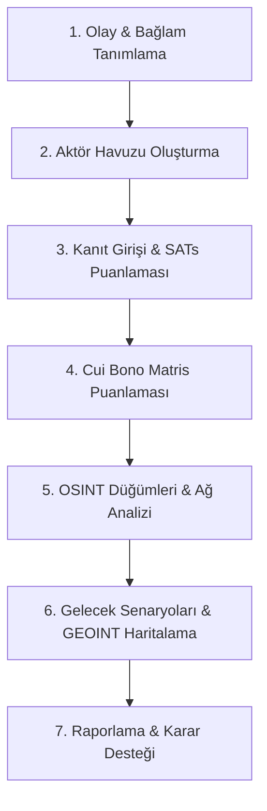

# CuiBono-IntelEngine: Adım Adım Analiz ve Kullanım Kılavuzu

**CuiBono-IntelEngine**, Yapılandırılmış Analitik Teknikler (**SATs - Structured Analytic Techniques**) ve Açık Kaynak İstihbaratı (**OSINT**) yöntemlerini kullanarak karmaşık güvenlik, siber saldırı, sabotaj ve jeopolitik krizlerde *"Cui bono?"* (Kimin Çıkarına?) sorusunun yanıtını matematiksel ve mantıksal bir çıkar matrisiyle hesaplayan analitik karar destek platformudur.

---

## 📌 Analizin Gerçekleşmesi İçin Sırasıyla Yapılması Gereken İşlemler

Aşağıdaki 7 aşamalı iş akışı, istihbarat döngüsüne (Intelligence Cycle) uygun olarak tasarlanmıştır:

---

### Adım 1: Olay ve Bağlamın Tanımlanması (Modül 1)
Analizin sınırlarını ve konusunu belirleyin.
1. **Olay Başlığı:** İncelenen vakanın net ve tanımlayıcı adını girin (Örn: *Kritik Enerji Boru Hattı Sabotajı*).
2. **Olay Tarihi:** Olayın gerçekleştiği veya kamuoyuna sızdığı tarihi seçin.
3. **Olay Özeti:** Olayın operasyonel bağlamını, hedeflenen varlığı ve ilk etki sahasını özetleyin.
4. **"Olayı Kaydet"** butonuna basarak vakanın IndexedDB veritabanında oluşturulmasını sağlayın.

> 💡 **İpucu:** Olay bağlamı ne kadar net olursa, Modül 5'teki Gemini AI motoru çıkar hipotezlerini o kadar isabetli türetir.

---

### Adım 2: Aktör Havuzunun Oluşturulması (Modül 2)
Olaydan doğrudan veya dolaylı fayda ya da zarar sağlayabilecek tüm aktörleri ekleyin.
1. **Aktör Adı:** Devlet, hacker grubu, konsorsiyum veya ticari kuruluşu yazın (Örn: *APT29*, *Konsorsiyum X*, *Devlet Y*).
2. **Başlangıç Hipotez Rolünü Seçin:**
   * **Doğrudan Çıkar Sağlayan (Direct Winner):** Olaydan birincil kazanç hedefleyen ana aktör.
   * **Fırsatçı (Opportunist):** Olayı başlatmasa da ortaya çıkan güç boşluğundan faydalanan.
   * **Dolaylı Kazanan (Collateral Beneficiary):** Olayın yan etkileriyle kazanç sağlayan üçüncü taraf.
   * **İsnat Edilen Fail (Accused Culprit):** Kamuoyunda fail olarak gösterilen ancak asıl kazanan olmayabilecek taraf.
3. **"Aktör Ekle"** butonuna basarak aktörleri listeye dahil edin.

---

### Adım 3: Kanıt Girişi ve SATs Güvenilirlik Değerlendirmesi
Toplanan açık kaynak istihbaratını (OSINT) Yapılandırılmış Analitik Teknikler (**SATs**) ile tartın.
1. **Kanıt Başlığı ve Kaynak Türü:** URL, Finansal Rapor (FININT), Sinyal/Ağ İzi (SIGINT) veya Sızdırılan Belge (DOCUMENT).
2. **Referans/Hash:** Kaynak linki veya SHA256 dosya özeti.
3. **4 Kriterli SATs Puanlaması (1 ile 5 arası):**
   * **Aidiyet (Attribution):** Bilginin kaynağı ve fail bağlantısı ne kadar net?
   * **Yetkinlik (Credentials):** Kaynak teknik açıdan ne kadar uzman ve güvenilir?
   * **Nesnellik (Objectivity):** Kaynağın çıkar çatışması veya manipülasyon riski var mı?
   * **Doğrulanabilirlik (Verifiability):** Bulgular bağımsız verilerle teyit edilebiliyor mu?
4. **Güvenilirlik Çarpanı:** Sistem otomatik olarak $\frac{\text{Toplam Puan}}{20}$ formülüyle $0.10$ ile $1.00$ arasında bir katsayı üretir.

---

### Adım 4: Cui Bono Matris Puanlaması (Modül 3 & Modül 5)
Her aktörün olay neticesinde 4 ana kategorideki kazanç veya kaybını belirleyin:
1. **Puanlama Skalası (-5 ile +5):**
   * **Finansal (FININT):** Pazar payı, hisse hareketleri, emtia fiyatları, ihale kazanımları.
   * **Politik / Jeopolitik:** Bölgesel etki, ittifak dengeleri, seçim/rejim çıkarı.
   * **Siber / Veri:** Sızdırılan kritik veriler, fikri mülkiyet, operasyonel üstünlük.
   * **İtibar / Algı:** Caydırıcılık, kamuoyu desteği, dezenformasyon başarısı.
2. **Hücre Gerekçesi:** "Gerekçe Yaz" düğmesine basarak analitik gerekçenizi ekleyin.
3. **Gemini AI ile Otomatik Skorlama (Modül 5):**
   * Gemini API anahtarınızı girin.
   * Ham haber veya istihbarat metnini yapıştırın.
   * "AI ile Analiz Et" butonuna basarak yapay zekanın yönetici sentezi ve antitez (Şeytanın Avukatı) önerilerini tek tıkla matrise uygulayın.
4. **Ağırlıklı Net Skor:** Her hücredeki ham puan, ilişkili kanıtların güvenilirlik çarpanıyla çarpılarak toplanır:
   $$\text{Net Skor} = \sum (\text{Ham Skor} \times \text{Kanıt Çarpanı})$$
   En yüksek net puana sahip aktör tablonun altındaki **"En Olası Nihai Yararlanan"** çubuğunda 1. sıraya yerleşir.

---

### Adım 5: OSINT Düğümleri ve Çıkar Ağ Analizi (Modül 4)
Aktörlerin dijital ayak izlerini ve operasyonel altyapısını görselleştirin.
1. İlgili aktörü seçin.
2. Kategori belirleyin: **Sosyal Medya (@)**, **Kripto Cüzdan (0x...)**, **Araç/Plaka** veya **Domain/IP**.
3. Etiket ve değeri girip "Düğüm Ekle" butonuna basın.
4. SVG Ağ Grafiğinde **Olay &rarr; Aktörler &rarr; OSINT Düğümleri** arasındaki hiyerarşik bağları inceleyin.

---

### Adım 6: Gelecek Senaryoları (Futures) & Coğrafi Haritalama (GEOINT)
1. **Alternatif Gelecekler Matrisi (Modül 6):** İki temel belirsizlik ekseni belirleyin (Örn: X: Yaptırım Şiddeti, Y: Siber Tehdit Yayılımı). Oluşan 4 kadran için olası senaryoları not edin.
2. **GEOINT Haritası (Modül 7):** Harita üzerinde doğrudan tıklayarak koordinat alın; Komuta Merkezi (HQ), Siber Hedef (TARGET) veya Düğüm (NODE) noktaları ekleyin.

---

### Adım 7: Raporlama ve Dışa Aktarım (Modül 9)
1. **Zaman Çizelgesi (Modül 8):** Olay ve kanıtların kronolojik akışını doğrulayın.
2. **Dışa Aktarım:**
   * **PDF / Sayfayı Yazdır:** Resmi istihbarat bülteni çıktısı alın.
   * **.cuibono.json İndir:** Tüm vaka dosyasını şifrelenebilir JSON olarak bilgisayarınıza yedekleyin.
   * **Markdown Olarak Kopyala:** Rapor özetini panoya aktarın.
   * **Vaka JSON İçe Aktar:** Geçmiş vakaları yükleyerek analizlere devam edin.

---

## 🔒 Güvenlik ve Gizlilik
* **Zero-Server / İstemci Tarafı:** Tüm analiz verileriniz, kanıtlar ve API anahtarınız sunucuya gönderilmez; tamamen tarayıcınızın yerel **IndexedDB** ve **localStorage** alanında saklanır.
* **Şeffaflık:** Gemini API çağrıları doğrudan istemcinizden Google AI uç noktalarına şifreli (HTTPS) olarak iletilir.
